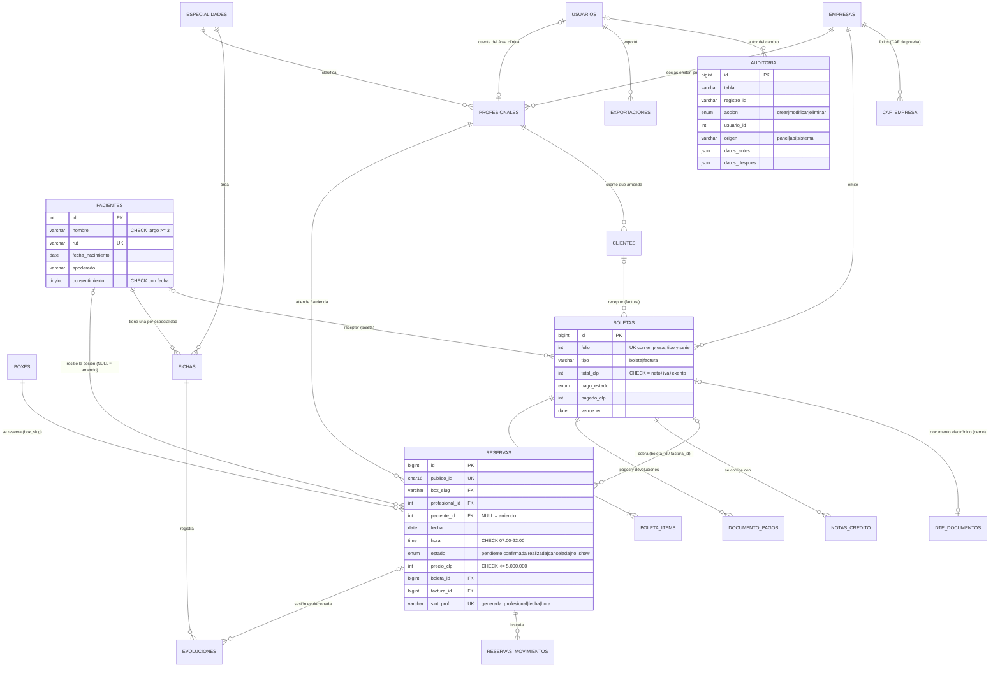

# Modelo de datos, migraciones y respaldo

Base MariaDB 11.8 (`utf8mb4_unicode_ci`, InnoDB). **45 tablas** (40 del sistema original + `auditoria`, `exportaciones`,
`ia_consultas`, `rate_limits` y `phinxlog`), **4 vistas** de reportes, **34 restricciones CHECK**, **37 claves foráneas** y **52 disparadores** (2 de cupo y
calendario heredados, 2 de flujo de estados y 48 de auditoría). El esquema se crea solo con migraciones Phinx versionadas.

## 1. Diagrama entidad-relación (entidades principales)

Cardinalidades clave: un **paciente** tiene a lo más **una ficha por especialidad** (`UNIQUE (paciente_id, especialidad_slug)`);
una **atención** pertenece a un box y a un profesional, y opcionalmente a un paciente; una **boleta** cobra una o varias
atenciones (`reservas.boleta_id`) y una **factura** agrupa las horas de arriendo de un cliente en un mes (`reservas.factura_id`).

## 2. Diccionario de datos (tablas principales)

### `reservas`: atención (entidad principal: 5.520 filas, 12 meses de historia)
| Columna | Tipo | Nulo | Restricción | Descripción |
|---|---|---|---|---|
| id | BIGINT UNSIGNED | No | PK, AUTO_INCREMENT | Identificador interno. |
| publico_id | CHAR(16) | No | UNIQUE | Código público (enlaces y búsqueda). |
| box_slug | VARCHAR(60) | No | índice `idx_box_fh` | Box reservado (`boxes.slug`). |
| profesional_id | INT UNSIGNED | Sí | FK `profesionales.id` | Profesional que atiende o arrienda. |
| paciente_id | INT UNSIGNED | Sí | FK `pacientes.id` ON DELETE SET NULL | Paciente de la sesión; NULL = arriendo de box. |
| modalidad_label | VARCHAR(120) | No | | Texto de la prestación («Sesión de fonoaudiología», «Arriendo de box»). |
| tipo_atencion | VARCHAR(40) | Sí | validado en API | evaluacion, intervencion, orientacion_familiar, etapas_vida, otro. |
| precio_clp | INT UNSIGNED | Sí | CHECK ≤ 5.000.000 | Precio de la sesión u hora de box. |
| fecha / hora | DATE / TIME | No / Sí | CHECK hora 07:00 a 22:00; disparador: no domingos ni feriados | Inicio de la atención. |
| duracion_min | SMALLINT | Sí | CHECK 15 a 480 | Duración (NULL = 60). |
| estado | ENUM | No | disparador `trg_reservas_transicion` | Estado del flujo. |
| origen | VARCHAR(30) | No | | web (agenda en línea) o panel. |
| boleta_id / factura_id | BIGINT | Sí | FK `boletas.id` | Documento que la cobró. |
| slot_prof | VARCHAR(160) | Sí | columna generada + UNIQUE | Impide que un profesional tenga dos reservas web en la misma hora. |
| creado_en / actualizado_en | TIMESTAMP | No | | Fechas de alta y última modificación. |

### `pacientes`
| Columna | Tipo | Nulo | Restricción | Descripción |
|---|---|---|---|---|
| id | INT UNSIGNED | No | PK | |
| nombre | VARCHAR(200) | No | CHECK largo ≥ 3 | Nombre completo. |
| rut | VARCHAR(20) | Sí | UNIQUE; DV validado en API | Formato 12.345.678-5. |
| documento_tipo / documento_numero | VARCHAR | No / Sí | UNIQUE compuesto | Pacientes extranjeros (pasaporte). |
| email | VARCHAR(200) | Sí | CHECK formato | Contacto. |
| fecha_nacimiento | DATE | Sí | CHECK ≥ 1900-01-01; API: no futura | |
| apoderado, apoderado_rut, apoderado_telefono | VARCHAR | Sí | API: obligatorio si es menor | Tutor (receptor de la boleta). |
| prevision | VARCHAR(60) | Sí | API: debe existir en `previsiones` | FONASA, isapre, etc. |
| consentimiento / consentimiento_fecha | TINYINT / DATETIME | No / Sí | CHECK: si hay consentimiento, hay fecha | Ley 20.584. |
| activo | TINYINT | No | | Baja lógica. |

### `boletas`: boletas y facturas (2.446 filas, todas de demostración)
| Columna | Tipo | Nulo | Restricción | Descripción |
|---|---|---|---|---|
| id | BIGINT | No | PK | |
| folio, tipo, serie, empresa_id | INT, VARCHAR, ENUM, INT | No | UNIQUE (empresa, tipo, serie, folio); CHECK tipo ∈ {boleta, factura}; CHECK folio > 0 | Folio del CAF de prueba. |
| receptor_* | VARCHAR | parcial | | **Copia** de los datos del receptor al emitir (ver §3). |
| paciente_id / cliente_id | INT | Sí | FK | Receptor según tipo. |
| neto_clp, iva_clp, exento_clp, total_clp | INT UNSIGNED | No | CHECK total = neto + iva + exento | Montos del documento. |
| nc_clp, nd_clp, pagado_clp | INT | No | recalculados por `recalcularPago` | Notas y pagos acumulados. |
| pago_estado | ENUM pendiente/parcial/pagado | No | | Estado de cobro. |
| vence_en / pagado_en | DATE / DATETIME | Sí | | Para días de pago y cuentas vencidas. |
| estado | ENUM emitida/anulada | No | CHECK: anulada ⇒ anulada_en | |
| sii_estado, sii_track_id | ENUM, VARCHAR | | | En la demo: `aceptada` simulada y `DEMO-…`. |

### Otras tablas
| Tabla | Propósito | Claves y restricciones destacadas |
|---|---|---|
| `profesionales` | Profesionales (socias y externos) | UNIQUE slug; FK especialidad; `user_id` vincula la cuenta del área clínica. |
| `especialidades` | Catálogo (5) | PK `slug`. |
| `boxes` | 5 boxes con tarifas JSON | UNIQUE slug. |
| `fichas` / `evoluciones` | Ficha clínica por especialidad y sus notas de sesión | UNIQUE (paciente, especialidad); CHECK cierre ≥ apertura; evoluciones con borrado lógico (Ley 20.584). |
| `clientes` | Quienes arriendan boxes (receptores de factura) | UNIQUE rut; CHECK email. |
| `documento_pagos` | Pagos (+) y devoluciones (−) | FK boletas ON DELETE CASCADE; CHECK monto ≠ 0. |
| `notas_credito` / `notas_debito` (+ ítems) | Correcciones de documentos | UNIQUE (empresa, serie, folio); CHECK total. |
| `dte_documentos` (+ det, ref), `sii_envios`, `caf_empresa` | Motor DTE en **modo demo** | UNIQUE (empresa, tipo, folio, ambiente); CHECK tipo ∈ {33, 34, 39, 41, 52, 56, 61}; CHECK rango de folios. |
| `usuarios` | Cuentas y rol | UNIQUE email; rol ∈ {admin, editor, pacientes, gerencia}; contraseña bcrypt. |
| `auditoria` | Bitácora de cambios | índices por (tabla, registro), usuario y fecha; CHECK JSON válido. |
| `exportaciones` | Quién exportó qué reporte, formato, filtros y filas | FK usuarios. |
| `ia_consultas` | Uso del servicio de IA (sin datos personales) | FK usuarios. |
| `rate_limits` | Contadores de límite de tasa | PK clave. |
| `regiones`, `comunas`, `previsiones`, `feriados`, `horario_centro`, `disponibilidad`, `configuracion` | Catálogos y configuración | UNIQUE y CHECK de horarios (fin > inicio, día 1 a 6/1 a 7). |

## 3. Normalización

El modelo está en **tercera forma normal** en sus entidades maestras: cada atributo depende solo de la clave (pacientes,
profesionales, boxes, clientes, catálogos de regiones, comunas, previsiones y especialidades en tablas propias; ítems y
pagos de un documento en tablas hijas). Las desnormalizaciones son **deliberadas y documentadas**:

1. **Datos del receptor en `boletas` (`receptor_nombre`, `receptor_rut`, …):** un documento tributario es inmutable; si el
   paciente cambia de dirección, la boleta emitida debe seguir mostrando lo que se emitió.
2. **`nc_clp`, `nd_clp`, `pagado_clp`, `pago_estado` en `boletas`:** acumulados recalculados en una sola función
   (`recalcularPago`) para listar miles de documentos sin agregar pagos en cada consulta.
3. **`reservas.nombre/email/telefono`:** copia del contacto al reservar en línea (el visitante puede no ser paciente aún).
4. **`reservas.slot_prof`:** columna **generada** para imponer unicidad condicional (no hay índices parciales en MariaDB).

## 4. Migraciones versionadas (Phinx, `database/migrations`)

| Versión | Clase | Qué hace | Reversible |
|---|---|---|---|
| V1 `20261123000000` | `EsquemaBase` | 40 tablas y 2 disparadores del sistema original + catálogos públicos (`database/sql/*.sql`). | No (solo a mano, con respaldo). |
| V2 `20261123000100` | `RolesYAuditoria` | Rol `gerencia`; tabla `auditoria`; 48 disparadores AFTER INSERT/UPDATE/DELETE generados desde `information_schema`. | Sí |
| V3 `20261123000200` | `RestriccionesCheck` | 31 restricciones CHECK (tercer nivel de validación), probadas contra los datos del sistema real. | Sí |
| V4 `20261123000300` | `FlujoEstadosReserva` | Disparadores de transición de estados y de fecha cumplida. | Sí |
| V5 `20261123000400` | `VistasReportes` | `v_atenciones`, `v_documentos`, `v_ingresos_diarios`, `v_kpi_mensual`. | Sí |
| V6 `20261123000500` | `SoporteApi` | `rate_limits`, `exportaciones`, `ia_consultas` e índices de reportes. | Sí |

Datos de prueba: `database/seeds/DatosSinteticos.php` (determinista, semilla 20261122; bloqueado salvo en bases «demo»/«test»).
Genera 520 pacientes, 10 profesionales, 8 clientes, 5.520 atenciones entre noviembre de 2025 y diciembre de 2026 con
estacionalidad (verano bajo, peak marzo a junio), tratamientos con alta, 2.446 documentos demo, pagos, notas de crédito,
459 fichas y 1.079 evoluciones. Ningún dato es real: nombres combinados al azar, RUT ficticios válidos, correos `@example.com`.

## 5. Consultas para reportes y dashboard

* **Filtros, orden y paginación:** `AtencionRepository::filtro()` arma el `WHERE` con parámetros; el `ORDER BY` sale de una
  lista blanca (`ORDENES`); `Repository::paginate()` devuelve `data` y `meta` (página, total, páginas).
* **Carga de relaciones:** las vistas resuelven los JOIN (box, profesional, especialidad, paciente, documento) en una sola
  consulta; el detalle de un documento trae ítems, pagos y notas en consultas acotadas por id.
* **Vistas:** `v_atenciones` (reporte operativo y todas las series), `v_documentos` (saldo, vencido, días de pago),
  `v_ingresos_diarios` (ingreso neto = documentos − NC + ND, idéntico al del panel clásico) y `v_kpi_mensual`.
* **Índices justificados:** `idx_res_fecha_prof_estado (fecha, profesional_id, estado)` para el reporte operativo y el
  dashboard por profesional; `idx_bol_fecha_tipo_pago (fecha_emision, tipo, pago_estado)` para el reporte de documentos;
  `idx_pac_creado` para el orden por antigüedad; más los heredados (`idx_box_fh`, `idx_prof_fh`, `idx_fecha_estado`).

## 6. Estrategia de respaldo y restauración

| Aspecto | Hosting (demo) | Docker |
|---|---|---|
| Herramienta | `sh tools/respaldo.sh respaldar` (mysqldump con `--single-transaction --routines --triggers`, gzip) | Servicio `backup` (`docker/backup.sh`, mariadb-dump) |
| Frecuencia | Diaria (cron) y antes de cada migración | Al iniciar y cada `BACKUP_INTERVAL` (24 h) |
| Retención | 14 días | 14 días (`BACKUP_RETENTION_DAYS`) |
| Ubicación | `~/respaldos_espacioluzdemo` (fuera de `public_html`, permisos 700) | Volumen `backups` |
| RPO / RTO | 24 h / 15 min | 24 h / 15 min |

**Prueba realizada (2026-11-23, hosting):** se respaldó la base (560 KB), se simuló un incidente vaciando
`documento_pagos` y `evoluciones`, se restauró y los conteos de 6 tablas, 52 disparadores y 4 vistas coincidieron;
la restauración tardó **1 s**. Registro completo: `docs/evidencias/respaldo/prueba_restauracion_hosting.txt`.
El pipeline repite la prueba en cada ejecución restaurando en un contenedor MariaDB aparte (`ci.yml`, paso «respaldo y
restauración»). La reversión de migraciones también se probó (`docs/evidencias/migraciones/reversion_hosting.txt`).
