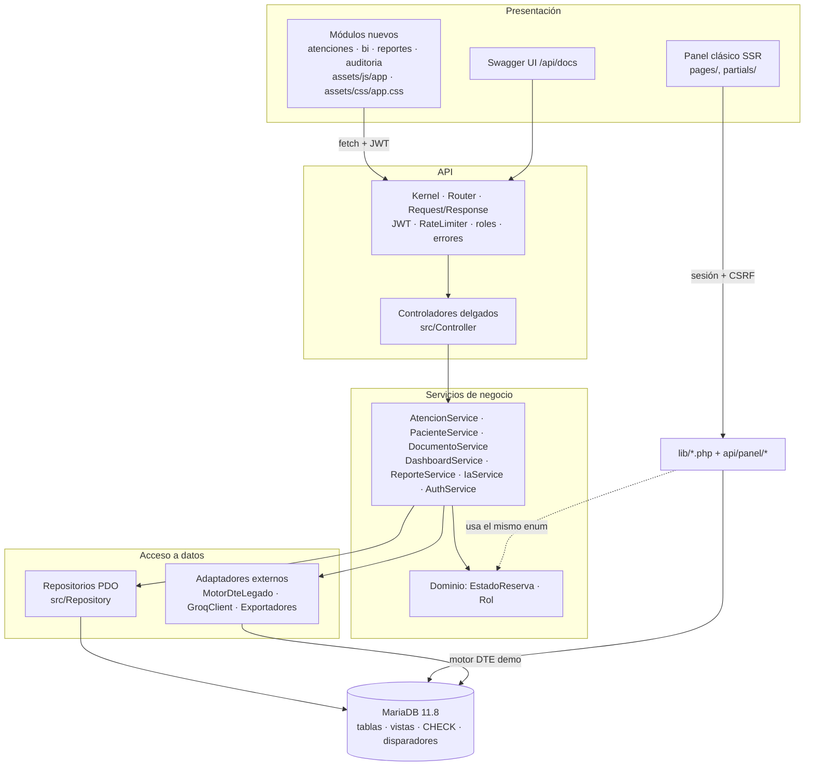
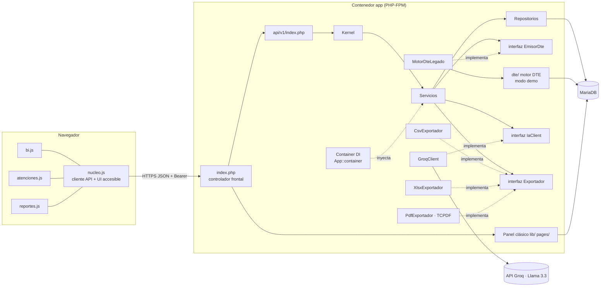
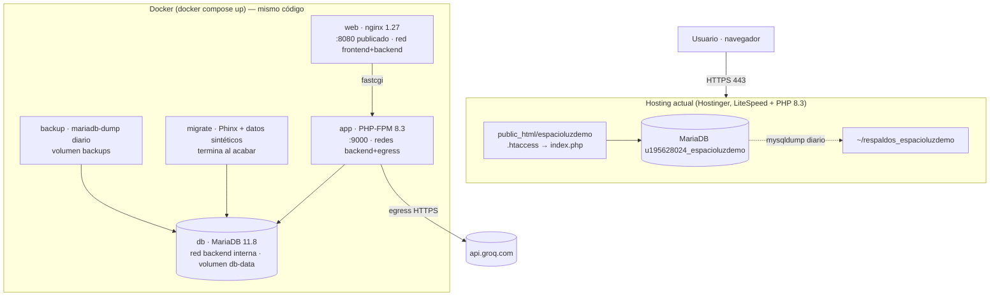
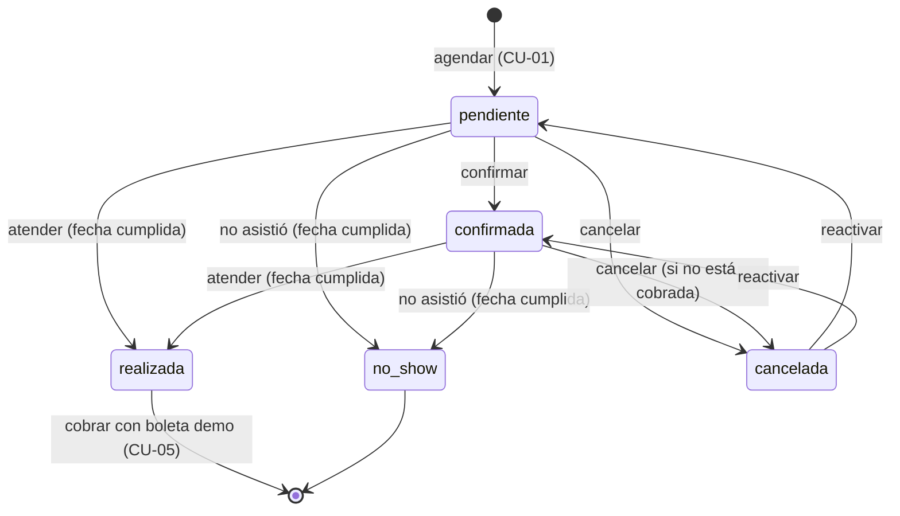

# 03 · Arquitectura de software

## 1. Visión general

Espacio Luz Demo es un **monolito modular en PHP 8.3** con dos superficies que comparten la misma base de datos y las
mismas reglas:

* **Sistema clásico renderizado en servidor** (heredado de EspacioLuz): sitio público, panel administrativo, fichas
  clínicas y el motor de documentos tributarios. Usa sesión PHP + token CSRF y endpoints internos `/api/panel/*`.
* **API REST `/api/v1` en capas** (nueva, `src/`): JWT, roles, validación, servicios de negocio y repositorios. La
  consumen los módulos nuevos del panel (Atenciones, Dashboard, Reportes, Auditoría), Swagger y cualquier integración.

Se eligió **evolucionar** el sistema real en vez de reescribirlo: el valor de negocio (agenda, fichas, cobros) ya existía
y la evaluación pedía un producto completo y coherente. Las reglas críticas se unificaron para que ambas superficies
no diverjan (flujo de estados, auditoría y validación en base de datos).

## 2. Capas

| Capa | Responsabilidad | No hace |
|---|---|---|
| Presentación | Renderizar, validar en el formulario (primer nivel), mostrar estados de carga/vacío/error, accesibilidad. | Reglas de negocio ni SQL. |
| API (`Kernel`, `Http`, `Controller`) | Enrutar, autenticar, limitar tasa, autorizar por rol, traducir JSON ↔ servicios, formato estándar de errores. | Decidir reglas (solo delega). |
| Servicios (`Service`, `Domain`) | Casos de uso y reglas: calendario, cupo, flujo de estados, cobro, privacidad por rol, indicadores. | Saber de HTTP o de SQL concreto. |
| Acceso a datos (`Repository`, adaptadores) | Todo el SQL (preparado, listas blancas), vistas, transacciones; integración con el motor DTE, la IA y los formatos de archivo. | Reglas de negocio. |
| Base de datos | Tercer nivel de validación (CHECK, FK, UNIQUE), flujo de estados y auditoría por disparadores, vistas. | — |

## 3. Diagrama de componentes

## 4. Diagrama de despliegue

Exportaciones SVG de todos los diagramas: `docs/diagramas/*.svg` (fuente `.mmd` junto a cada una). Puertos, redes, volúmenes y variables: ver `05_plan_despliegue.md` y `compose.yaml`. Solo `web` publica un puerto; la base
de datos vive en una red interna sin salida a internet; solo `app` tiene salida (para la IA).

## 5. Flujo de estados de una atención (patrón State)

## 6. Patrones de diseño aplicados (registro de decisiones)

| ADR | Decisión | Dónde | Por qué | Alternativas descartadas |
|---|---|---|---|---|
| ADR-01 | **Repository** | `src/Repository/*` (base `Repository`) | Aísla todo el SQL, permite paginar/filtrar de forma uniforme y probar servicios contra una base real en transacción. | ORM (Doctrine/Eloquent): agrega dependencia pesada y no encaja con 40 tablas heredadas con nombres en español; SQL en controladores: viola capas. |
| ADR-02 | **Inyección de dependencias** con contenedor mínimo | `src/Container.php`, `src/App.php` | Una sola raíz de composición; las pruebas reemplazan IA, motor DTE y conexión sin tocar servicios. | Service locator global o `new` dentro de servicios (acoplamiento); PHP-DI (dependencia innecesaria para ~30 servicios). |
| ADR-03 | **Adapter** sobre el motor DTE heredado | `Dte/EmisorDte` + `Dte/MotorDteLegado` | El motor original es procedural (mysqli); el adaptador lo expone como objeto y garantiza el **modo demo** sin reescribirlo. | Reescribir el motor (riesgo alto, sin valor para la demo); llamar funciones globales desde los servicios (acoplamiento). |
| ADR-04 | **Strategy** para exportar | `Export/Exportador` + CSV/XLSX/PDF | Agregar un formato no cambia el servicio de reportes ni el controlador (abierto/cerrado). | `switch` por formato dentro del servicio. |
| ADR-05 | **State** (máquina de estados en enum) | `Domain/EstadoReserva` + disparador V4 | Una sola tabla de transiciones usada por la API, el panel clásico y la base de datos. | Validar estados en cada pantalla (divergencias). |
| ADR-06 | Auditoría con **disparadores** | Migración V2 | Cubre todos los caminos (panel, API, motor DTE, scripts) sin modificar 50 archivos heredados. | Auditar en cada servicio (los módulos heredados quedarían fuera). |
| ADR-07 | **JWT HS256** propio | `Security/Jwt` | Sin dependencias, solo HS256 (rechaza `none`), revalida el usuario en cada solicitud. | Sesiones para la API (no es sin estado); librería externa (más superficie). |
| ADR-08 | IA solo con **agregados** | `IaService` | Ley 19.628/20.584: ningún dato clínico ni personal sale a un proveedor externo. | Enviar evoluciones para resumirlas (riesgo legal). |

## 7. Principios SOLID e inyección de dependencias en el código

* **S** — cada clase tiene una razón de cambio: `AtencionController` solo traduce HTTP; `AtencionService` las reglas;
  `AtencionRepository` el SQL; `PdfExportador` el formato PDF.
* **O** — nuevos formatos de exportación o proveedores de IA se agregan implementando `Exportador` o `IaClient`.
* **L** — `FakeIaClient` y `FakeEmisorDte` sustituyen a las implementaciones reales en las pruebas sin cambiar el
  comportamiento esperado por los servicios.
* **I** — interfaces pequeñas: `EmisorDte` (un método), `IaClient` (tres), `Exportador` (tres).
* **D** — los servicios reciben sus dependencias por constructor (`AtencionService(Database, AtencionRepository,
  PacienteRepository, CatalogoRepository, DocumentoRepository, EmisorDte, ?Closure $hoy)`); solo `App::container()` conoce
  las clases concretas.

## 8. Requerimientos no funcionales y cómo los atiende la arquitectura

| RNF | Mecanismo |
|---|---|
| Seguridad (OWASP API Top 10) | **API1 BOLA:** el área clínica solo ve atenciones/pacientes de su profesional (404 para lo ajeno). **API2:** JWT HS256 estricto, expiración, bcrypt, 5 intentos/min, mensaje único de error, revalidación de la cuenta. **API3:** listas blancas de campos al escribir; Gerencia no recibe datos de contacto ni nombres. **API4:** 120 solicitudes/min, `per_page` ≤ 100, exportación ≤ 20.000 filas, rango ≤ 2 años, IA 10/min. **API5:** roles por ruta y por reporte. **API8:** cabeceras de seguridad, CORS cerrado por defecto, errores sin trazas, archivos internos bloqueados. **API9:** versión `/v1` y contrato OpenAPI. **API10:** respuesta de la IA validada contra un esquema y con tiempo máximo. Además: SQL siempre preparado, CSRF en el panel, `httponly` y `samesite` en la cookie. |
| Rendimiento | Vistas e índices para reportes; paginación en servidor; caché de token en `sessionStorage`; consultas por agregación (no se traen filas al cliente). |
| Disponibilidad | Respaldos diarios con prueba de restauración automatizada; `restart: unless-stopped` y health checks en compose; reversión de migraciones probada. |
| Mantenibilidad | Capas, DI, 58 pruebas (unitarias + integración), contrato OpenAPI, CI. |
| Privacidad / cumplimiento | Datos sintéticos; minimización por rol; IA con agregados; modo demo imposible de desactivar por configuración. |
